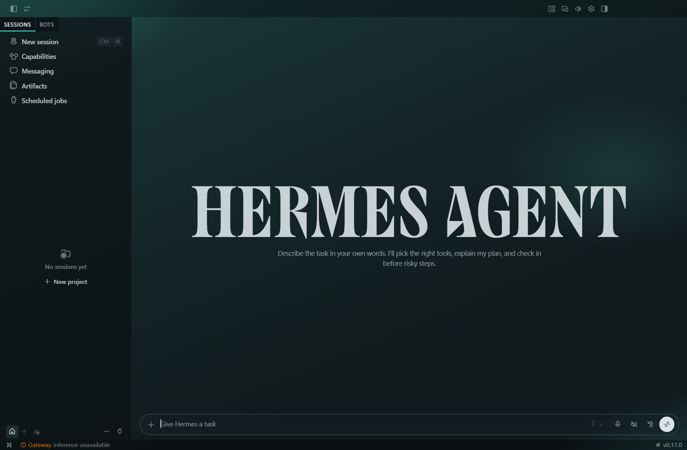
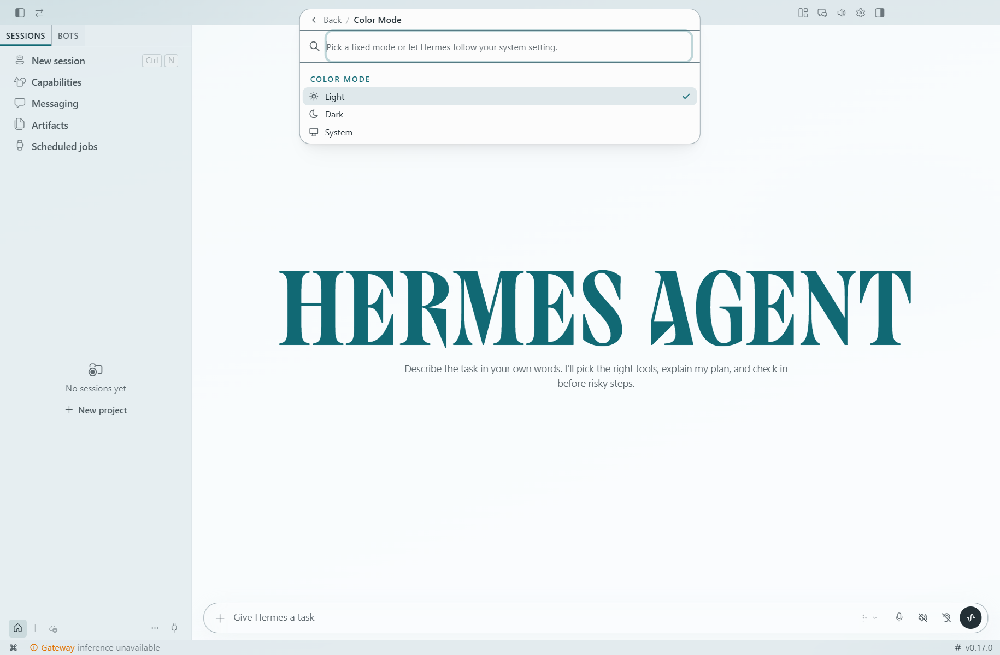
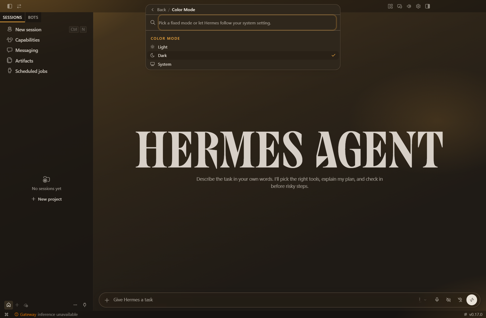
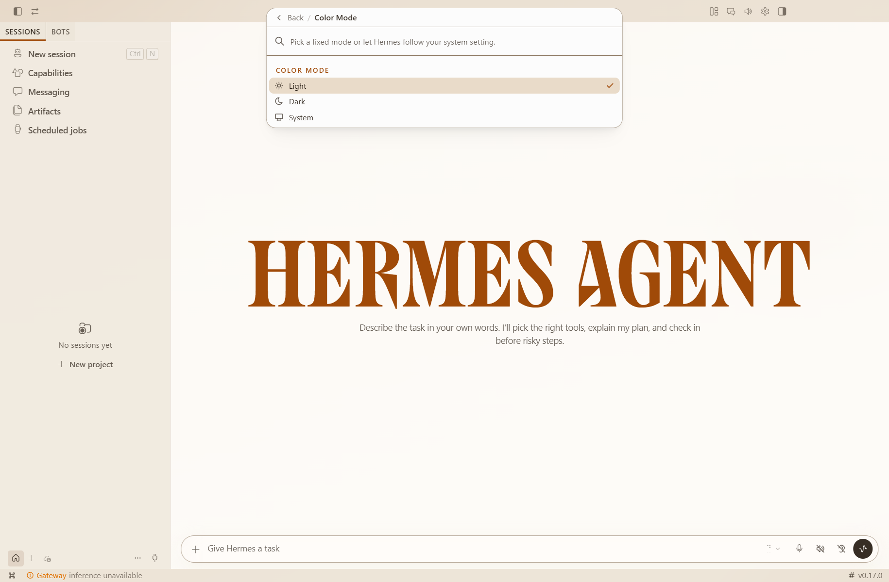
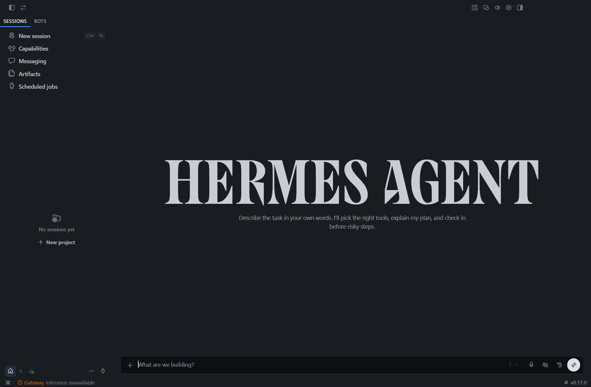

# hermes-desktop-plugins

**Four desktop plugins for the Hermes desktop app: two measured glass themes, a low-vision
typeface, a legibility pass and a personal kanban board. Install one by copying a single folder.**

The Hermes desktop app ships one theme and one UI typeface. Its smallest labels render at 9 px and
10 px, and two of its five text tiers fail WCAG AA against the surface they actually render over —
I measured 2.98:1 and 3.84:1, both under the 4.5:1 floor for body text
([`docs/evidence/audit-baseline.json`](docs/evidence/audit-baseline.json)). Settings exposes the
*terminal* font, not the UI font, and no setting at all for the tiers, so the fix belongs in a
plugin.

This repository is that fix set: four plugins, two palettes and an install guide. Nothing here
edits the app's install tree, so `hermes update` cannot revert it, and deleting one folder is a
complete uninstall.

State: in daily use on my machine — Hermes desktop v0.17.0, Windows. The themes and the legibility
layer are finished. The kanban board is finished but personal: it reads two of my own markdown
files. I am not a designer; where a number below is a judgement call rather than a measurement,
the table says so.

## What is in here

| Plugin | What it changes | State |
| --- | --- | --- |
| [`glassy-panel`](plugins/glassy-panel/plugin.js) | Adds two themes, **Glacier Glass** (cool) and **Sunstone Glass** (warm), each with a dark and a light appearance — 25 colour roles each, a validated contrast contract, and a glass material set. | Finished, daily use |
| [`atkinson-font`](plugins/atkinson-font/plugin.js) | Swaps the UI typeface to **Atkinson Hyperlegible**, the Braille Institute's low-vision face. Optional second command for code. | Finished, daily use |
| [`legibility`](plugins/legibility/plugin.js) | One override layer: fixes two text tiers that fail WCAG AA, clamps every sub-11 px call site, and answers three OS accessibility preferences the app ignores. | Finished, daily use |
| [`tracker-kanban`](plugins/tracker-kanban/plugin.js) | A `/board` page: tasks across 5 columns, projects across 6, read from two markdown files through a small Python backend. | Finished, personal |

## The two themes

Both themes are generated from a CIE L\* ladder rather than picked by eye, and both carry the same
25 colour roles as the app's stock skins: `background`, `card`, `muted`, `popover`, `primary`,
`secondary`, `accent`, `border`, `destructive`, `sidebarBackground`, `userBubble` and the
foregrounds that pair with each.

| | Glacier Glass | Sunstone Glass |
| --- | --- | --- |
| Family | cool slate, teal accent `#116974` light / `#45c8bf` dark | warm graphite, terracotta accent `#a04a08` light / `#e8a33d` dark |
| Light canvas / paper | `#eef2f4` / `#fbfdfe` | `#efe6d8` / `#fffdfb` |
| Dark canvas / paper | `#0d1417` / `#162024` | `#1b1714` / `#262019` |
| Surfaces | chrome, sidebar, editor, card, input, elevated — `color-mix` over the paper | same six |
| Material | `backdrop-filter: blur(20px) saturate(130%)` on the composer surface, specular top rim, depth shadow instead of a drop shadow | same |

The panel alphas differ by appearance on purpose — a dark translation reads through at 36 % paper,
a light one separates by its hairline instead of by value:

| Surface | Light | Dark |
| --- | --- | --- |
| chrome (titlebar) | 94 % paper | 72 % paper |
| editor (main canvas) | 88 % paper | 36 % paper |
| card / widget | 92 % paper | 45 % paper |
| composer input | 90 % paper | 44 % paper |
| sidebar | 74 % shell | 52 % shell |

**Every text and boundary pair was validated before either theme shipped.** `tools/contrast-report.py`
reads the colours straight out of `plugins/glassy-panel/plugin.js` and applies the WCAG 2.1 formula,
so the claim is reproducible rather than asserted:

```
$ python tools/contrast-report.py
- pairs checked: 68
- failures: 0
- tightest text pair: mutedForeground on background in sunstone-glass/light at 5.57:1
- tightest boundary pair: sidebarBorder on sidebarBackground in glacier-glass/light at 3.05:1
RESULT: PASS (68/68)
```

Full table: [`docs/measured-contrast.md`](docs/measured-contrast.md). The tightest pair in either
theme lands at 3.37:1 (Sunstone light, `border` on `background`), which is the same value the
design spec recorded for its own tightest pair — the script reproduces it independently.

The plugin's own header makes the claim in its own words — *"all 18 boundary and text pairs were
validated (text >= 4.5:1, boundaries >= 3:1)"* (`plugin.js:16`). The script below models 17 of
those: 11 text pairs and 6 boundary pairs, checked across the four appearances, which is the 68
above. It prints the list it checks, so the pair it does not cover is visible in the table rather
than implied by a total.









## The typeface

Atkinson Hyperlegible is not a taste. The Braille Institute drew it so that `I`, `l` and `1` — and
`O` and `0`, and `rn` and `m` — stop resolving into the same shape for a low-vision reader. The
plugin points the app's own UI font token at it, so every unstyled label, button and menu follows.

What changes, and what deliberately does not:

| | |
| --- | --- |
| Changed | `--dt-font-sans` → `Atkinson Hyperlegible`, with `Atkinson Hyperlegible Next` behind it for glyphs v1 lacks, then the app's own stack as the tail |
| Changed | Uppercase micro-labels get `letter-spacing: 0.02em`, because Atkinson is wider per glyph than the app's native face and the 11–12 px tiers read tight |
| Opt-in, second command | `--dt-font-mono` → `Atkinson Hyperlegible Mono` for code cards; off by default so the stock code pipeline is untouched |
| Weight caveat | Classic Atkinson ships Regular (400) and Bold (700) only, so `font-medium` (500) renders 400 and `font-semibold` (600) renders 700 — a coarser two-step, with no synthetic bold |
| **Not** changed | The terminal pane. xterm sets its font in JavaScript from `terminal.font_family` in `config.yaml` — set it there, e.g. `"Atkinson Hyperlegible Mono"` |
| **Not** changed | Keycap glyphs (`--dt-font-kbd`, deliberately the native UI face) and the `HERMES AGENT` wordmark, which is a brand face |

The font itself is not redistributed here: the plugin names the family and falls through to the
app's stack if it is missing. Install it from the
[Braille Institute](https://www.brailleinstitute.org/freefont/). The plugin has a *measure what is
rendering* command that compares rendered widths of the same string with and without the family in
front — equal widths mean the family did not resolve — so you can confirm the swap happened
instead of trusting it.

## The legibility pass

One override layer, measured on and off in a live window. Both columns are a real census of the
running app, taken from `docs/evidence/audit-baseline.json` (overrides off) and
`docs/evidence/audit-with-overrides.json` (overrides on).

| | Off | On |
| --- | --- | --- |
| `--ui-text-quaternary` over the editor | `#5b5f63`, **2.98:1** | `#7a7e83`, **4.69:1** |
| `--conversation-scaffold-meta` | `#6c7075`, **3.84:1** | `#7a7e83`, **4.69:1** |
| Labels rendering at 9 px | 2 (`sessions`) | 0 |
| Labels rendering at 10 px | 2 (`Ctrl`) | 0 |
| Labels at the 11 px floor | 3 | 4 |
| Labels at 12 px | 12 | 15 |
| Transcript body / line-height | 13 px / 18 px | 14 px / 20 px |
| Transcript tool output | 11 px | 12 px |
| Transcript captions | 12 px / 16 px | 13 px / 18 px |
| Interactive targets at 24×24 px | 22 | 10 |
| Composer control | 24 px | 28 px |
| Titlebar control | 24 px | 26 px |

How each one is done, because the mechanism matters if you want to copy it:

- **The two failing tiers** are opacity-derived — `color-mix(in srgb, var(--ui-base) 36%, transparent)`
  and `44%` over the canvas. The layer re-bases them to 50 %, which is theme-adaptive by
  construction: one rule fixes both appearances of all four themes. The plugin comment records the
  predicted values (2.96:1 → 4.6:1 and 3.87:1 → 4.6:1); the audit dump above records what the app
  actually rendered (2.98 → 4.69 and 3.84 → 4.69). Both are printed here because they are a
  measurement and a prediction, not a disagreement.
- **The type floor** clamps class-named call sites: the `text-[0.5rem]`…`text-[7px]`…`text-[10px]`
  family to `0.6875rem` (11 px), and the `text-[0.6875rem]`…`text-[0.73rem]`…`text-[11px]` family
  to `0.75rem` (12 px). Around 470 call sites in the app render below 12 px; the layer does not
  edit one of them.
- **Micro uppercase keeps its tracking** at the larger size (`0.045em`) or it reads as a smear.
- **Three OS preferences the app ignored** get answers:
  `@media (prefers-contrast: more)` raises four tiers again,
  `@media (prefers-reduced-transparency: reduce)` kills the glass field and the bloom,
  `@media (forced-colors: active)` hands the stroke tokens to `CanvasText` / `GrayText`.
  The app already honoured `prefers-reduced-motion`.
- **A live contrast report** ships with it: a Command Center command samples the real composited
  surface through a canvas (so `color-mix` and `oklab` resolve to actual pixels) and prints the five
  tiers' ratios in a notification. Measure the theme you have, in the appearance you are in.




## Install

A desktop plugin is one folder containing a `plugin.js`. That is the whole install.

1. Find your Hermes home — the directory holding `config.yaml`. On my Windows machine that is
   `%LOCALAPPDATA%\hermes\`. The plugin root is `$HERMES_HOME/desktop-plugins/`.
2. Copy the plugin folder in, keeping its name:

   ```sh
   cp -r plugins/atkinson-font "$HERMES_HOME/desktop-plugins/"
   cp -r plugins/glassy-panel   "$HERMES_HOME/desktop-plugins/"
   cp -r plugins/legibility     "$HERMES_HOME/desktop-plugins/"
   ```

   If you are updating one you already have, quit the app first — the loader watches these
   directories and hot-reloads edits, and quitting is the one way to be sure nothing is half-swapped.
3. Restart the desktop app, then open **Settings → Plugins** and check that the plugin is listed.
4. Apply it:
   - **Themes**: Command Center (`mod+K`) → *Appearance: Glacier Glass (cool glass)* or
     *Appearance: Sunstone Glass (warm glass)* — or pick either from **Settings → Appearance**.
   - **Atkinson**: it is on at load. `mod+alt+a` toggles it; Command Center also carries
     *turn off*, *Mono: turn on* and *measure what is rendering*.
   - **Legibility**: it is on at load. `mod+alt+l` toggles it; Command Center carries
     *toggle overrides* and *contrast report*.
   - **Board**: needs one extra step — see [The kanban board](#the-kanban-board).
5. **Turn one off** without uninstalling: **Settings → Plugins**, or the plugin's own toggle command.
   Settings is remembered in the plugin's storage, so it survives a restart.
6. **Uninstall**: delete the folder. There is nothing else to clean up — no `config.yaml` key, no
   install-tree edit. Every style layer is removed on unload and every scope attribute with it.

If a plugin stays stuck on, do not rename its folder in place: the loader scans *every* directory
under `desktop-plugins/` for a `plugin.js`, so `legibility.disabled/` still loads. Move it out of
the tree, to a sibling directory. Full notes, including the unified-package layout, are in
[`docs/install.md`](docs/install.md).

## What is measured and what is an opinion

| Measured (reproduce it) | Opinion (mine) |
| --- | --- |
| Every text and boundary ratio in both themes — `python tools/contrast-report.py` | Which theme looks better |
| The five text tiers on and off, the px census, the target sizes — the two audit JSONs | Whether 14 px is the right transcript body size |
| The panel alphas, material, radii and ring — `plugins/glassy-panel/plugin.js` | The shape of the bloom (three radials at 26/16/8 % light, 62/44/22 % dark) |
| The Atkinson width probe, rendered live by the plugin | That Atkinson is worth switching to, if you have never had trouble reading 11 px |
| 68/68 pairs pass; the tightest pair at 3.05:1 | That 3.05:1 is comfortable for a sidebar hairline — it is the floor, not a target |

## The kanban board

`tracker-kanban` is the odd one out: it is a page, not a skin. It renders a `/board` route
(sidebar row *Board*, plus a Command Center entry) with two rows of columns:

- **Tasks** — Today / This Week / Backlog / Waiting On / Done, parsed from `- [ ]` and `- [x]`
  items under `##` headings, including nested children. The row header counts open items.
- **Projects** — Ideas / Backlog / Active / Paused / Done / Abandoned, parsed from a pipe table
  with `name | status | next | touched | notes`. The header shows `active n/2` and marks the column
  when more than two projects are active at once.

It is read-only by design: the two markdown files stay the source of truth and the board is a view
of them. Refresh is cheap — the renderer polls `/version` (mtime + size per file) every 5 s and only
refetches `/board` when a token changes.

Because it reads *my* files, installing it needs two paths of your own. The backend lives next to
the desktop half, at `$HERMES_HOME/plugins/tracker-kanban/`:

```
$HERMES_HOME/plugins/tracker-kanban/
├─ plugin.yaml              # name, version, author, kind: dashboard
├─ dashboard/plugin_api.py  # GET /board, GET /version  (FastAPI)
└─ desktop/plugin.js        # the page (copy of plugins/tracker-kanban/plugin.js)
```

1. Copy `plugins/tracker-kanban/` to `$HERMES_HOME/plugins/tracker-kanban/desktop/`, and
   `plugins/tracker-kanban/plugin.yaml` + `dashboard/plugin_api.py` to
   `$HERMES_HOME/plugins/tracker-kanban/`.
2. Add `tracker-kanban` to `plugins.enabled` in `config.yaml` — the route is server-side, so the
   desktop toggle in Settings → Plugins is not enough on its own.
3. Point the backend at your files. The defaults in `plugin_api.py` are placeholders, not paths:

   ```sh
   export TRACKER_KANBAN_TASKS="/path/to/tasks.md"
   export TRACKER_KANBAN_TRACKER="/path/to/tracker.md"
   ```

4. Restart. `GET /api/plugins/tracker-kanban/board` should return your two files as JSON.

## Write your own

The four plugins here are the examples, and between them they cover the parts of the contract you
will actually need: the theme area, the palette/Command Center area, the keybind area, a route with
a sidebar entry, plugin storage, host notifications, a React-rendered page without a build step, and
a plugin with a Python backend half.

Three rules that I had to learn from the app's own source:

1. **An inline style beats every selector.** The theme provider writes tokens as
   `root.style.setProperty('--dt-font-sans', …)` on `<html>`, so a plain `:root { … }` rule does
   nothing. A stylesheet `!important` declaration does beat inline, and unlayered CSS beats the
   app's `@layer base` — that combination is the only one that wins.
2. **Scope everything to a `data-*` attribute on `<html>`**, and remove that attribute plus your
   `<style>` element in `ctx.onDispose`. That is what makes disabling a true revert instead of a
   restart-and-hope.
3. **Raise specificity deliberately when you are fighting another override layer.** The themes use
   `:root:root[data-hermes-theme=…]` for exactly that reason: an override layer of *equal*
   specificity would otherwise win on DOM order alone.

- [docs/writing-a-plugin.md](docs/writing-a-plugin.md) — end-to-end walkthrough, using the font
  plugin as the template, including the pitfalls that cost me the most time.
- [docs/plugin-api.md](docs/plugin-api.md) — the contract: where plugins load from, the module
  shape, `ctx`, the registration areas, and the CSS-override ladder.

## Compatibility

Barrier to entry: none. No build step, no bundler, no `npm install` — plain ESM loaded uncompiled,
with `jsx()` calls instead of JSX syntax, and `react` / `@hermes/plugin-sdk` / `react/jsx-runtime`
supplied by the app.

Everything here was built and measured against **Hermes desktop v0.17.0 on Windows**. Two of the
four plugins override app CSS and app design tokens, which means a future app release can break
them: the legibility layer names specific Tailwind-style class strings and `--ui-*` tokens, and the
themes key off `data-hermes-theme`, `data-slot` and `data-contrib-shell`. If a label goes small
again after an update, the class names moved. The themes and the font plugin are the robust two —
they only touch tokens the app documents by name.

## What works and what does not

- Works, in daily use: both themes (dark and light), the Atkinson swap, the legibility layer, the
  board on my own files.
- Works but untested by anyone else: the board's two file paths — it assumes a `##`-sectioned
  checkbox list and a 5-column pipe table.
- Never measured: the light-appearance glass over a populated transcript (every measured screenshot
  here is the empty session surface), the board on files it did not grow up with, and macOS.
- Not attempted: a light theme that keeps translucency in `prefers-reduced-transparency`, per-tier
  font-size settings instead of class clamping, and Windows high-contrast beyond the stroke tokens.

## Repository layout

```
plugins/                the four plugins — copy a folder into $HERMES_HOME/desktop-plugins/
  atkinson-font/        UI typeface → Atkinson Hyperlegible
  glassy-panel/         two themes, both appearances, the material layer
  legibility/           contrast tiers, type floor, OS preferences, live contrast report
  tracker-kanban/       the /board page + plugin.yaml + the FastAPI backend
themes/                 the two palettes as 14-role theme JSON (canvas / paper / ink / line /
                        primary / primaryDeep / onPrimary / accent / danger…). Every role in
                        both appearances of both palettes appears verbatim among the 25 seeds
                        glassy-panel registers — read the plugin to see the surface roles the
                        palette does not name
tools/contrast-report.py  parses plugin.js and prints the WCAG table (68 pairs)
docs/
  install.md            every install, disable and uninstall path
  writing-a-plugin.md   build one end to end
  plugin-api.md         the SDK surface and the override ladder
  measured-contrast.md  the generated contrast table
  evidence/             the two on/off censuses quoted above: contrast ratios, px census,
                        target sizes, transcript tokens
  img/                  the six captures referenced above
  screenshots/          the shots still missing, and what each one needs to show
  third-party/          the Atkinson typeface's OFL text
  owner-todos.md        what I still owe this repo
```

## Credits

- **Atkinson Hyperlegible** — Copyright 2020 Braille Institute of America, Inc., SIL Open Font
  License 1.1. No font binary is redistributed here; the licence text travels with the family name
  at [`docs/third-party/atkinson-hyperlegible-OFL.txt`](docs/third-party/atkinson-hyperlegible-OFL.txt).
  Get the font from [brailleinstitute.org/freefont](https://www.brailleinstitute.org/freefont/).
- **Hermes Agent** and **`@hermes/plugin-sdk`** (Nous Research) — the app the plugins load into and
  the SDK they import from. Not vendored, not modified.
- **`glassy-panel-design`** (Hermes skill library; author Nous Research, MIT) — the spec these two
  themes were built to: its CIE L\* ladder, its material table and its 18-pair contrast contract.
  The plugin header cites the sections.
- **`apple-design`** (Hermes skill library) — the HIG review that produced the finding list
  `legibility` implements: the two failing text tiers, the sub-12 px census, the three ignored OS
  preferences and the 24 px control size.
- **`hermes-desktop-plugins`** (Hermes skill library) — the loader, hot-reload, disable and
  uninstall semantics that `docs/install.md` documents.

Licensed MIT — see [LICENSE](LICENSE).
